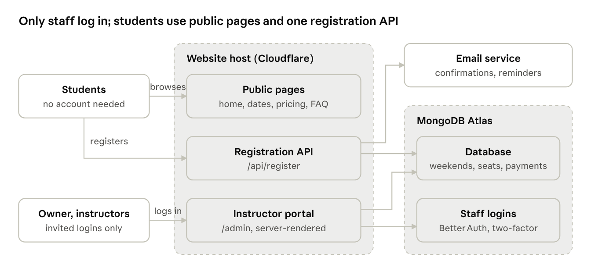
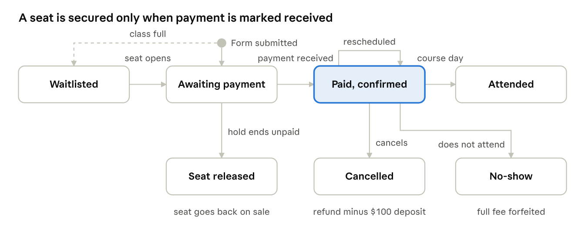

# Firearms Academy Canada — Website Roadmap

As of November 20, 2026. Copied from the shared doc: https://claude.ai/artifact/4tHAajjWDcPkazLAGxgRnh (edit there or here; they do not sync automatically).

## Where the site stands

The website, database, staff portal and automatic emails are built and tested. What stands between the new site and
going live is mostly setup and content: accounts (Cloudflare, Resend), a few settings, a privacy policy page, photos, and
moving the domain. Card payments and the extras listed under "Later" come after launch.

**Built and working**

- **Public site.** Astro 7, 12 pages, redesigned with the navy / red / cream palette. Old `.php` URLs redirect (301) to
  the new pages. SEO basics are in place: per-page titles and descriptions, a sitemap, and business details for Google.
- **Live course dates.** The home and dates pages read course weekends from the database, showing seats left and
  "Full" automatically. Past weekends hide themselves.
- **Registration.** Saved to MongoDB Atlas, and the student gets a seat straight away. Afterwards they see e-Transfer
  instructions with the amount and a unique payment reference such as `FAC-0116-SMITH-K7Q`, and are asked to pay within
  48 hours (placeholder). Seats can never be oversold.
- **Unpaid students stay until the owner removes them.** Nothing is released automatically. The Payments page lists
  every unpaid registration with the date it was made, and **Remove** cancels it, frees the seat and emails the student.
- **Contact form.** Messages are stored and shown in the portal.
- **Staff portal at `/admin`.** Owner and instructor logins with:
  - a dashboard;
  - course weekends: add, change seats, close, cancel, assign instructors;
  - class lists with a printable sign-in sheet;
  - payments: look up a reference, mark paid, remove unpaid students, record cash or other amounts, refunds;
  - moving or cancelling a registration;
  - consent form, attendance and staff notes per student;
  - contact messages;
  - an email log with a preview of every email.
- **Automatic emails (Resend).** Eight emails, from registration to class reminders (see Emails below). They start
  sending once a Resend key is added.
- **Hourly job** (Cloudflare cron trigger). Sends class reminders and instructor class lists; it never changes registrations or seats.
- **Audit log.** Records every staff change (who, what, when).
- **Hosting.** Deployed to Cloudflare Workers at the demo domain https://mreinhart-fac-demo.com, with the hourly job
  scheduled. Search engines are asked not to index the demo; indexing turns on once the site moves to firearmsacademy.ca.

**Not built yet** (see Later)

- Staff management in the portal (staff are added with `npm run staff:create`).
- Two-factor login.
- Waitlist.
- CSV export and emailing a whole class.
- Editing packages and prices in the portal (they stay in `src/data/courses.js`).
- Refund amounts suggested from the policy.
- Card payments.
- Deleting old student records on a schedule.

## Launch checklist

- [ ] **e-Transfer address.** Set `etransfer.email` in `src/data/site.js`, ideally an address with Interac Autodeposit
  turned on. Until then, the payment page and emails say the address will be sent separately.
- [x] **Database.** MongoDB Atlas is set up with indexes and 13 course weekends.
- [x] **First staff login** created with `npm run staff:create`.
- [x] **Atlas network access.** The deployed Worker reaches Atlas (Cloudflare Workers have no fixed IP addresses, so
  Atlas must keep allowing them; the database user's strong password is the protection).
- [ ] **Email.** Partly done: the Resend account exists, and its key, sender and owner address are stored in Cloudflare.
  Until firearmsacademy.ca is verified, the site sends from Resend's test sender (`onboarding@resend.dev`), which only
  delivers to the Resend account owner, so owner notices arrive but emails to students fail. Still to do: add
  `firearmsacademy.ca` in Resend (Domains), add its DNS records (SPF and DKIM) plus a DMARC record, then change
  `EMAIL_FROM` to an address on the domain, set `EMAIL_REPLY_TO` to a real inbox, and update both in Cloudflare.
- [x] **Hosting.** Deployed with `npm run deploy` (November 20, 2026); the database, login and hourly-job secrets are
  stored in Cloudflare. Still to do: confirm the account is on Workers Paid (US$5/month), and add the Resend secrets.
- [x] **Version control.** In a private GitHub repository: https://github.com/MReinhart1/fac.
- [ ] **Booking rules.** The owner confirms seats per class (20 now) and how soon students are asked to pay (48 hours now).
- [ ] **Content check.** The owner reads every page, especially the home-page copy, prices, policy and hunter-education
  contacts.
- [ ] **Photos and logo.** Real classroom photos and the FAC logo replace the text badge.
- [ ] **Privacy policy page.** Drafted at `/privacy` and linked from the footer and both forms. Until the owner fills in
  `privacy` in `src/data/site.js` (how long records are kept, and a name and email for privacy questions), the page shows
  "to be confirmed" in those places and a draft notice at the top. Worth a quick legal read before launch.
- [ ] **Domain cutover.** Point firearmsacademy.ca at the Worker without breaking the business email (see below).

Nice before launch, not blocking: check the old external links on the Links page, and test every email once Resend is set
up (the portal's **Emails** page previews each one).

## Architecture

An Astro site on Cloudflare Workers, with MongoDB Atlas for data, Better Auth for the staff login and Resend for email. At
about 30 students a month and 5 staff logins the data stays tiny (around 1 MB a year). Static pages are served as files.
The date pages, `/api/*`, `/admin/*` and the hourly job run in the Worker.

Payments sit outside this picture. e-Transfers go straight to the owner's bank and are marked paid in the portal. Card
payments, if added later, would happen on the processor's own page, which then notifies the site.

| Piece | Choice | Notes |
| --- | --- | --- |
| Website | Astro 7 with the Cloudflare adapter | Home and dates pages are cached at Cloudflare's edge for 60 seconds and refreshed whenever seats change |
| Database | MongoDB Atlas, Flex tier | One connection per request, because Workers can't share connections between requests. Flex takes daily backups |
| Login | Better Auth with its MongoDB adapter | Email and password, invite-only, minimum 12 characters; sessions last 7 days. Logins are stored in the same database |
| Email | Resend | Free plan covers this volume. Every email is recorded in the portal's email log, sent or not |
| Hosting | Cloudflare Workers Paid | Runs the MongoDB driver with `nodejs_compat`. Serves old `.php` URLs as 301s and runs the hourly cron trigger for the scheduled emails. The free plan's 10 ms of CPU per request is too little for staff sign-in |
| Payments | Interac e-Transfer now; maybe cards later | No card data ever touches the site |

Students do not get accounts. They register as guests and receive everything by email; only the owner and instructors log
in.

## Data model

Five collections, plus the login collections Better Auth creates for itself. Packages, prices and the class location stay
in code (`src/data/courses.js`, `src/data/site.js`), because they rarely change. Money is stored in cents; course dates
are calendar dates in Toronto time.

| Collection | Holds | Key fields |
| --- | --- | --- |
| `courseSessions` | One course weekend (not called `sessions`, which Better Auth uses) | Saturday date (unique), capacity, seats taken, status (open, closed, cancelled), assigned instructors, notes, class list emailed |
| `registrations` | A student booked into a weekend, with payments inside | payment reference (unique), weekend, package, amount due, has own guide, status (pending, paid, cancelled), student (name, nickname, email, phones), friend to sit with, comments, earlier-date waitlist wish, PAL course date and instructor (restricted-only packages), consent form received, attendance, staff notes, payments and refunds (method, amount, date, recorded by, note), cancel reason, moves, class reminder sent |
| `messages` | Contact-form messages | name, email, message, read by, read at |
| `auditLog` | Who changed what | staff member, action, record, details, time |
| `emailLog` | Every email the site tried to send | recipients, template, subject, registration, status (sent, not sent, failed), Resend ID, error |
| Better Auth's own | Logins | `user` (with role: `admin` = owner, `user` = instructor), `session`, `account`, `verification` |

**Seat counting.** Each weekend keeps a seats-taken count. A seat is taken with one atomic update that only succeeds while
seats taken is below capacity, in the same transaction as the registration, so two people can never take the last seat.
Only cancelling gives the seat back: an unpaid registration keeps its seat until staff remove it.

## Staff portal

Works on a phone, so the class list can be checked at the Legion Hall door.

| Screen | What it does | Owner | Instructor |
| --- | --- | --- | --- |
| Dashboard | Next class (seats, paid and unpaid count), unpaid total, unread messages, payment reference search | Yes | Their weekends, no money |
| Course weekends | Add a weekend; change seats; close, cancel, reopen; assign instructors; staff notes; show past weekends | Yes | View their weekends |
| Class list | Everyone booked: package, paid status, guide, friend, consent form; print sign-in sheet | Yes, with amounts and references | Their weekends, without amounts |
| Registration | All answers, payment history, emails sent. Record payment (any method and amount), cancel with a refund, move to another weekend, each with an optional email to the student. Consent form, attendance and notes | Yes | Consent, attendance and notes only |
| Payments | Unpaid list with the date each registered; find a reference; one-click "mark paid" or "remove" | Yes | No |
| Messages | Contact-form messages; mark read | Yes | No |
| Emails | Log of every email; preview each template | Yes | No |

Staff are invite-only: nobody can sign up on the site, and the owner creates logins from the command line.

## Payments

Interac e-Transfer is the payment method. Every registration carries one payment reference, which is how money is matched
to a student.

Built today: awaiting payment (pending), paid, cancelled, and rescheduling. There is no automatic "seat released" step:
an unpaid student keeps the seat until the owner removes them, which is recorded as a cancellation with the reason "Not
paid". Attended and no-show are recorded on the registration page. The waitlist is not built yet; students can only tick
"put me on the waitlist for an earlier date".

**e-Transfer.** The student sees the amount and reference after registering and in their email. The owner searches the
reference in the portal and clicks *Mark paid*, and the student is emailed their course confirmation. A later improvement
could read the bank's deposit notifications and propose matches, but a person would still confirm each one.

**Cards (not built).** Use the payment page of a processor that approves a firearms-training business in writing: Stripe
Checkout, or the merchant account the old site already uses. Card numbers would never touch the site. Stripe lists
firearms businesses as restricted (approved case by case), and Square's Canadian terms ban firearms sales
([Stripe](https://stripe.com/en-gb-ca/legal/restricted-businesses), [Square](https://squareup.com/ca/en/legal/general/ua)).

**Cancellation policy.** The owner applies these by hand today: the refund amount is typed when cancelling, and no
reschedule fee is charged automatically.

| Situation | Rule from the current policy |
| --- | --- |
| Cancel 14+ days before | Refund minus the $100 non-refundable deposit |
| Cancel within 14 days | Only if the seat is filled from the waitlist |
| Cancel or reschedule within 48 hours | Not accepted |
| First reschedule, 7+ days before | Free |
| Second reschedule | $75 service charge |
| Reschedule under 7 days before | $100 service charge |
| No-show | Full fee forfeited |

## Emails

Eight automatic emails, sent from the business's own domain through Resend. The wording lives in
`src/lib/email/templates.js`. A failed email never blocks a registration or a staff action, and each scheduled email can
only go out once.

| Email | To | Sent when |
| --- | --- | --- |
| Registration received, with e-Transfer details and reference | Student | They register |
| New registration | Owner | Someone registers |
| New contact message | Owner | Contact form sent |
| Course confirmation (dates, which day(s), address, map, what to know) | Student | Owner marks paid (optional on the registration page) |
| Moved or cancelled (with refund amount, or a "not paid" note when an unpaid student is removed) | Student | Owner moves, cancels or removes (optional on the registration page) |
| Class reminder | Paid students | 3 days before the course, after 9 a.m. Toronto time |
| Class list | Instructors assigned to the weekend | 2 days before the course, after 9 a.m. |

These are transactional messages, so they need no marketing consent under Canada's anti-spam law (CASL). A newsletter
would need opt-in consent and an unsubscribe link. The domain needs SPF, DKIM and DMARC records so messages are not filed
as spam.

## Privacy and security

Storing student records makes the business responsible for them under PIPEDA, the federal privacy law that covers private
businesses in Ontario. This is a starting checklist, not legal advice.

- **Collect only what is used.** The form asks for name, contact details, course choice, and (for restricted-only
  packages) the PAL course date and instructor. No date of birth, PAL number or ID scans.
- **Privacy policy page** (drafted at `/privacy`, waiting for the owner's answers): what is collected, why, who sees it (owner, instructors, and the email, hosting
  and database providers), how long it is kept, and who to contact.
- **Minors.** The portal records only whether a signed consent form was received; the paper form stays with the owner.
- **Access.** Staff logins only, invite-only, and instructors see only their own classes. Every change is written to the
  audit log. Two-factor login for the owner is not built yet.
- **Storage.** Atlas encrypts data at rest and in transit. Choose a Canadian region if one is offered for the tier.
- **Payments.** No card data on the site or in the database, ever.
- **Retention.** Delete or anonymize student records a set time after the course (the owner chooses the period). This is
  not automated yet.
- **Backups.** Atlas Flex takes a snapshot every day and keeps the last 8; the owner also keeps a monthly export.
- **Breaches.** PIPEDA requires reporting a breach that creates a real risk of significant harm to the Privacy
  Commissioner and to affected people, and keeping a record of every breach for 24 months.
- **Accessibility.** The site follows WCAG practices (contrast, keyboard use, labels). WCAG 2.0 AA is good practice even
  though Ontario's AODA web rules mainly bind larger organizations.

## Costs

The full site should cost about **US$15 a month, roughly CA$21**: Cloudflare Workers Paid, the Atlas database and the
domain. The estimate assumes up to 30 students a month, 5 staff logins and 150–300 automatic emails a month. Prices were
checked on each provider's pricing page on November 20, 2026.

| Provider | Used for | Plan | Monthly |
| --- | --- | --- | --- |
| Cloudflare Workers | Hosting, server code, edge cache, hourly job | Workers Paid: US$5 minimum, including 10 million requests and 30 million CPU ms. Cached pages and cron runs count as ordinary requests, far below the allowance | US$5 |
| MongoDB Atlas | Database | Flex: US$8 up to 100 operations a second (5 GB storage), stepping up to a US$30 cap only under heavy load | US$8 |
| Better Auth | Staff login | Open-source library, stored in Atlas | US$0 |
| Resend | Automatic emails | Free: 3,000 emails a month, 100 a day, 3 domains. Pro is US$20 for 50,000 if ever needed | US$0 |
| Domain renewal | firearmsacademy.ca | Existing registrar (or Cloudflare Registrar) | about US$2 (not checked) |
| **Total** | | | **about US$15** |

**Card payments, if added.** Stripe's standard Canadian rate is 2.9% + CA$0.30 per payment (more for cards issued
abroad). That is about CA$7.79 on a CFSC package ($258.30) and CA$13.36 on the complete package ($450.40). At 20 card
payments a month, that comes to roughly CA$160–270 a month. Receiving e-Transfers is usually free, but some business bank
accounts charge per e-Transfer received; check with the bank.

Not included: development time, photography, and any legal review of the privacy policy. Sources:
[Cloudflare Workers pricing](https://developers.cloudflare.com/workers/platform/pricing/),
[Atlas Flex costs](https://mongodb.com/docs/atlas/billing/atlas-flex-costs),
[Atlas Flex backups](https://mongodb.com/docs/atlas/backup/cloud-backup/flex-cluster-backup),
[Resend pricing](https://resend.com/pricing),
[Stripe Canada](https://support.stripe.com/questions/2024-pricing-update-for-canadian-businesses).

## Domain cutover, in order

1. Find out where firearmsacademy.ca's DNS and email are hosted today, and get the login.
2. Test every page, redirect, form and the staff portal on the demo domain, https://mreinhart-fac-demo.com.
3. Move the domain's DNS to Cloudflare. Copy every existing record first, especially MX (business email) and the Resend
   records. Then change the domain in `astro.config.mjs` (`SITE_URL`) and `wrangler.jsonc` (`BETTER_AUTH_URL`, `routes`)
   to firearmsacademy.ca and deploy. That attaches the domain and lets search engines index the site.
4. Confirm HTTPS works, old `.php` links redirect, a test registration arrives in the portal, and its emails are delivered.
5. Submit the sitemap in Google Search Console and update the Google Business Profile link.
6. Keep the old hosting account for a month as a fallback, then cancel it.

## Later

None of these block launch. They are roughly in order of usefulness.

| Item | What it adds |
| --- | --- |
| Staff page | Owner adds, removes and resets instructor logins in the portal instead of the command line |
| Two-factor login | Extra protection for the owner account |
| Waitlist | Full weekends take waitlist sign-ups; a "seat open" email goes out when a seat frees up |
| Policy helpers | Portal suggests the refund or reschedule fee from the cancellation policy; owner confirms |
| Class tools | CSV export of a class list; email the whole class |
| Record retention | Automatically anonymize student records after the chosen period |
| Packages and prices in the portal | Owner edits prices without a code change |
| Card payments | After written approval from a processor (about a week of work) |
| Exam results | Written and practical scores per student; would make the CRFSC module's "within 30 days" rule checkable |

## Open questions for the owner

- [ ] Which email address receives e-Transfers, and is Autodeposit on?
- [ ] Where are the domain's DNS and email hosted, and who has the login?
- [ ] How many seats per class? Is capacity different for Saturday (CFSC) and Sunday (CRFSC)?
- [ ] How soon should students pay after registering (48 hours now), and how long does the owner wait before removing an unpaid student?
- [ ] How many instructors need logins?
- [ ] How long should student records be kept after a course?
- [ ] Are photos of classes available, and is the FAC logo available as a vector file?
- [ ] Which company processes cards on the old site today? An existing approved merchant account avoids a new approval.
- [ ] Is cash accepted on course day? (The portal can already record cash payments.)
- [ ] Should exam results be recorded in the system?
